# StudyLab

**A study planner for Portuguese students** — Pomodoro timer, timetable, homework & test reminders, study statistics and a grade calculator that follows the Portuguese rules (Ensino Básico and Secundário). Built natively for **iPhone, Apple Watch and Mac**, plus a **Windows** app.

*O teu planeador de estudo.* The whole interface is in European Portuguese (pt-PT).

> Not affiliated with any school or government body. The grading rules were researched from public sources (see [Grades](#grades-portuguese-rules)) — always check your school's own rules.

## Screenshots

| iPhone | | |
|:--:|:--:|:--:|
| 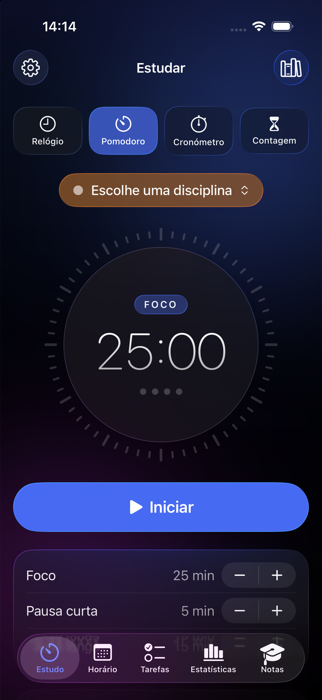 | 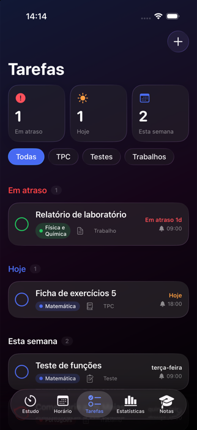 | 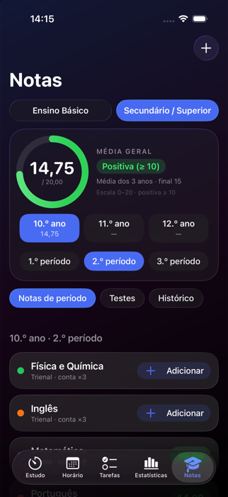 |

**Mac**

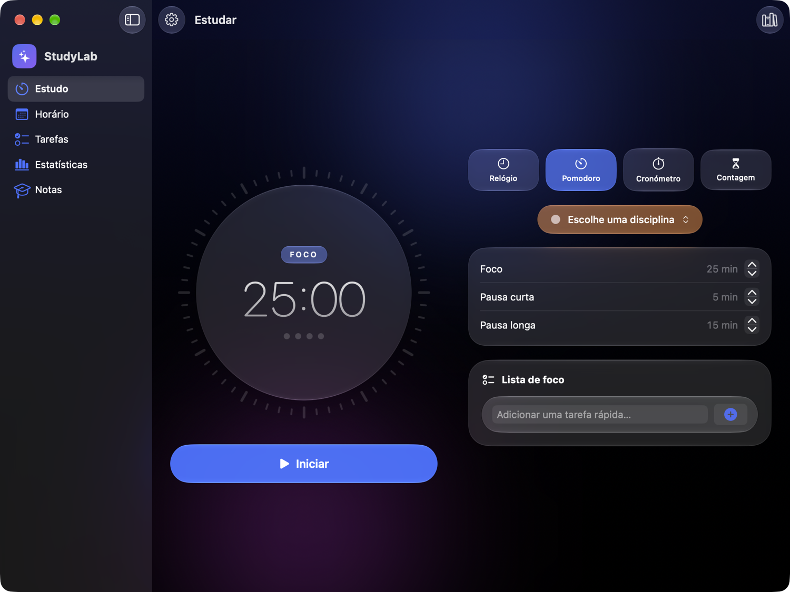
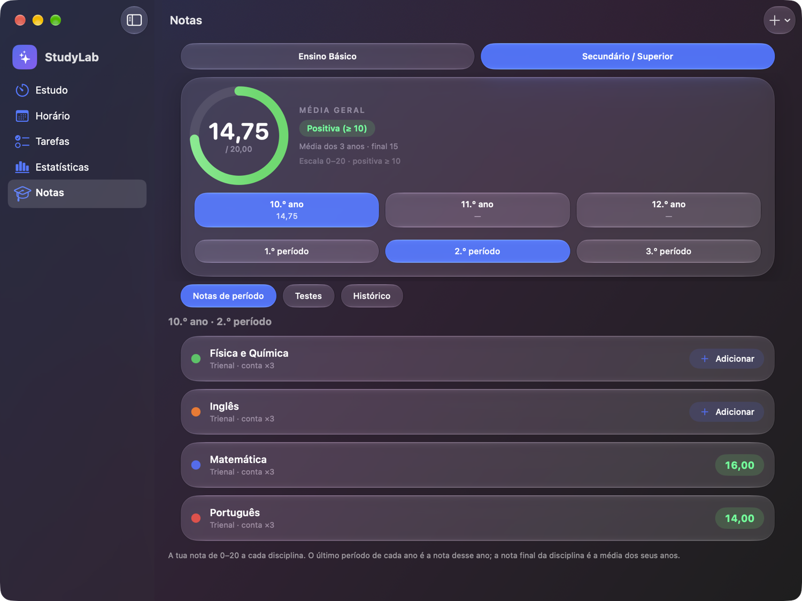

**Windows**

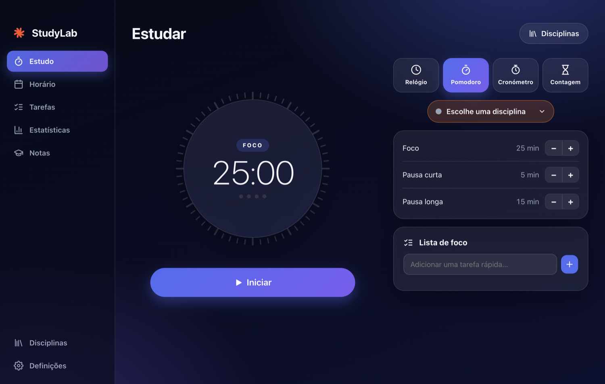
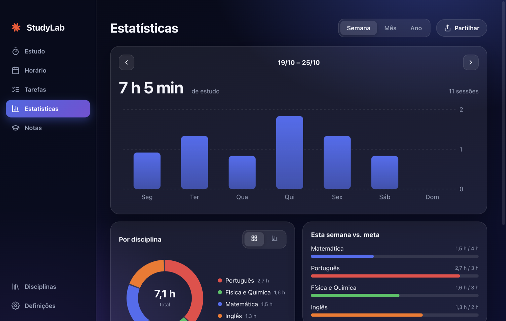

<details>
<summary>More screenshots</summary>

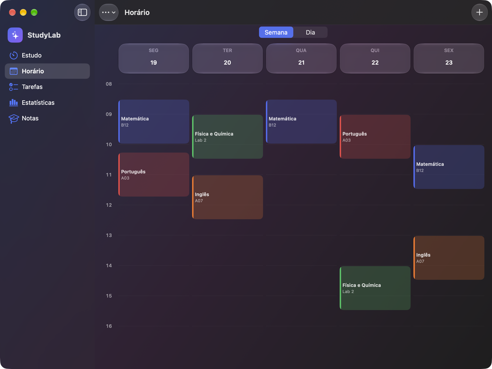
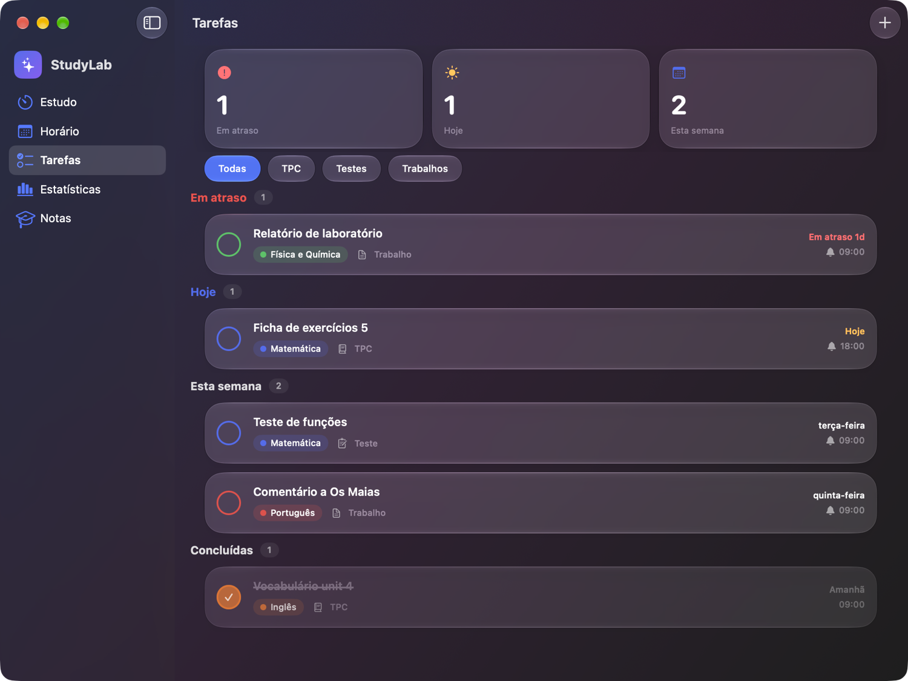
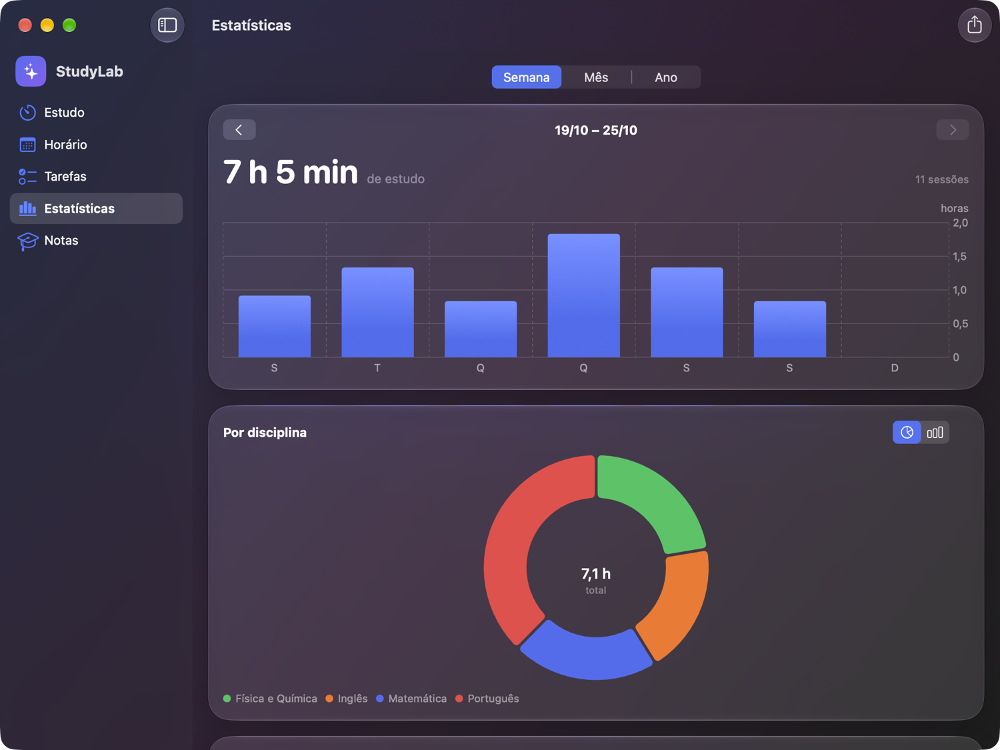
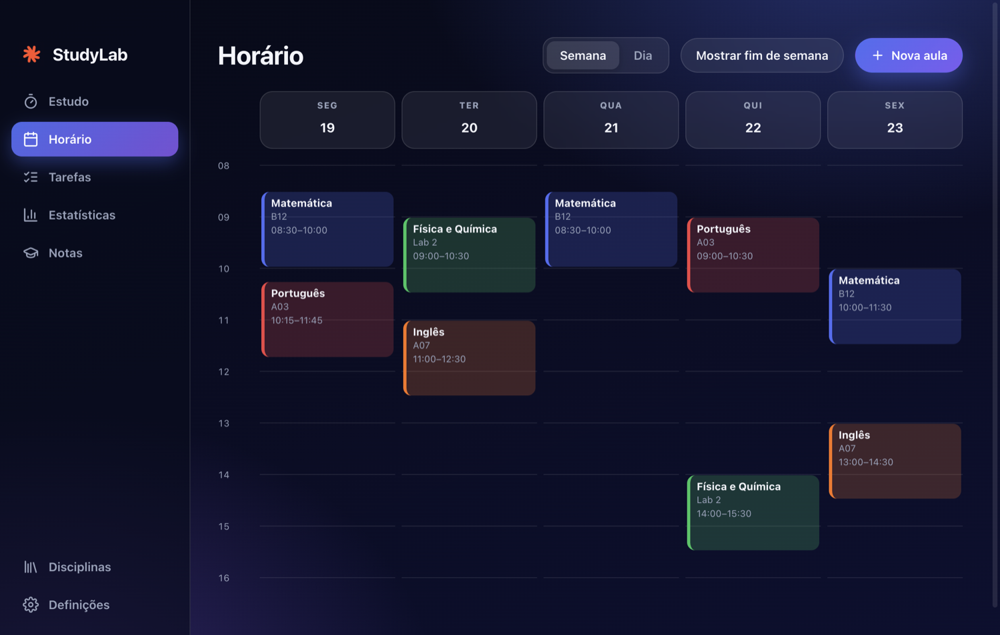
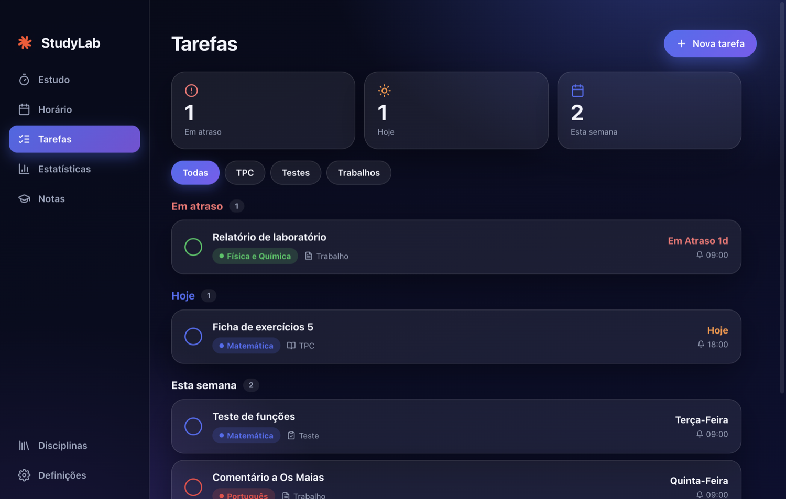
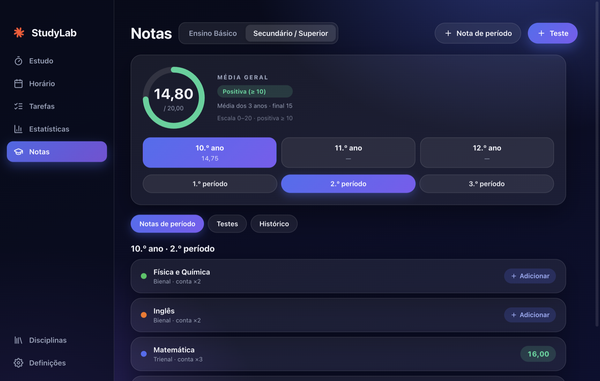
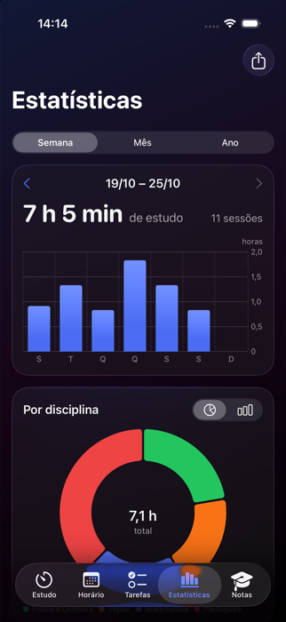
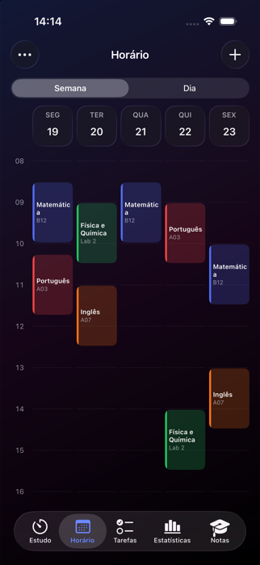

</details>

## Features

- **Study hub** – clock, Pomodoro, stopwatch and countdown. A subject is required, sessions are logged automatically, and there is a focus checklist for each session.
- **Timetable** – weekly grid and day view, with a "now" line.
- **Tasks** – homework (TPC), tests and assignments with filters and reminders (a test reminds you 1 week, 3 days, 1 day and 2 hours before).
- **Statistics** – study time per week/month/year, per subject, weekly goals, task completion, and a **"share with parents"** report (image or text).
- **Grades** – Portuguese rules, see below.
- **Native on every platform** – iOS 26 *Liquid Glass* design, Live Activities and Dynamic Island for the running timer, a Mac sidebar app, an Apple Watch companion, and a Windows app with system-tray reminders.
- **Private by design** – everything is stored on your device. No accounts, no analytics, no servers.

## Platforms

| Platform | Folder | Stack |
|---|---|---|
| iPhone / iPad | `apple/StudyLab` | SwiftUI, SwiftData, Swift Charts, ActivityKit |
| Apple Watch | `apple/StudyLabWatch` | SwiftUI, WatchConnectivity (watchOS 10+) |
| Mac | `apple/StudyLab` (`StudyLabMac` target) | SwiftUI, same code as iPhone with a Mac layout |
| Windows | `windows/` | Electron, React, TypeScript, Vite |

The three Apple apps share one SwiftUI code base. The iPhone app pushes subjects, timetable and tasks to the watch, and the watch sends finished study sessions back.

## Grades (Portuguese rules)

- **Ensino Básico** – tests are marked 0–100 % (red below 50 %, yellow 50–65 %, green above), and every subject gets a **1–5 term mark** per period. The overall average is the mean of the term marks.
- **Ensino Secundário** – subjects have a 0–20 mark per period in the 10.º, 11.º and 12.º year. A year's mark is its latest period; a subject's final mark is the mean of its years; the **course average is weighted by subject duration** (3-year subjects ×3, 2-year ×2, 1-year ×1, as in the current rules). The weighting can be switched off in the settings.
- National exams (25 %/30 % of a subject's final mark) are **not** included yet.

Sources: [gov.pt – conclusion of secundário](https://www.gov.pt/noticias/novas-condicoes-para-concluir-ensino-secundario-e-aceder-ao-ensino-superior), [examesnacionais.com.pt](https://www.examesnacionais.com.pt/calculo_media_final_secundario_acesso_ao_ensino_superior.php).

## Build it yourself

### Apple (iPhone, Watch, Mac)

Requirements: a Mac with **Xcode 26 or later** and [XcodeGen](https://github.com/yonaskolb/XcodeGen).

```bash
brew install xcodegen
cd apple
xcodegen generate
open StudyLab.xcodeproj
```

1. In `apple/project.yml`, change `bundleIdPrefix`, the `PRODUCT_BUNDLE_IDENTIFIER` values and the watch's `INFOPLIST_KEY_WKCompanionAppBundleIdentifier` to your own, and add `DEVELOPMENT_TEAM: <your team id>` under `settings: base:`. Run `xcodegen generate` again.
2. Pick the **StudyLab** scheme (iPhone + widget + Apple Watch) or **StudyLabMac**.
3. Run on a simulator, or on your own device.

Tips:
- Build from a folder that is **not synced by iCloud** (for example `~/Developer`). iCloud adds hidden file attributes that make code signing fail.
- In debug builds you can start the app with the environment variable `STUDYLAB_DEMO=1` to fill it with demo data (used for the screenshots).

### Windows

Requirements: Node.js 20 or later.

```bash
cd windows
npm install
npm run dev          # the interface in your browser, with hot reload
npm start            # build and open the Electron app
npm run dist:win     # build the Windows installer (works from macOS and Linux too)
```

The installer is created in `windows/release/`. It is not code-signed, so Windows SmartScreen will warn on first run.

## Project structure

```
apple/
  StudyLab/            iPhone + Mac app (Models, Views, Services, Extensions)
  StudyLabWatch/       Apple Watch app
  StudyLabWidgets/     Live Activity / Dynamic Island extension
  Shared/              Code shared with the watch and the widget
  project.yml          XcodeGen project definition
windows/
  electron/            Main process (window, tray, notifications)
  src/                 React app (pages, grade maths, timer, store)
docs/screenshots/
```

## Roadmap

- Chrome and Safari extensions (focus timer and website blocker)
- Sync between devices
- Grade planner with the national exams and university access average
- Microsoft Store (MSIX) and App Store releases

## Resumo em português

O StudyLab é uma aplicação de estudo para alunos portugueses: temporizador Pomodoro, horário, TPC e testes com lembretes, estatísticas de estudo (com relatório para partilhar com os pais) e uma calculadora de notas que segue as regras do Ensino Básico (testes 0–100 %, nota de período 1–5) e do Secundário (0–20, média ponderada pela duração das disciplinas). Funciona em iPhone, Apple Watch, Mac e Windows, toda em português de Portugal. Os dados ficam apenas no teu dispositivo.

## License

[MIT](LICENSE) © 2026 StudyLab

## Contact

Questions, ideas or bugs? Open an issue or write to [apoio@studylab.pt](mailto:apoio@studylab.pt).
