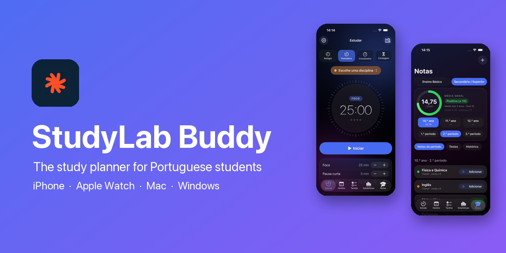

<div align="center">


# StudyLab Buddy

**The study planner built for Portuguese students.**
Pomodoro timer · timetable · homework & test reminders · study stats · grade calculator

<br>

[](LICENSE)


-22c55e?style=for-the-badge)


<br>



</div>

<br>

## ✨ Highlights

| | |
|---|---|
| ⏱ **Study hub** | Clock, Pomodoro, stopwatch and countdown. Pick a subject, tick off a focus checklist, and sessions are logged automatically. |
| 📅 **Timetable** | Weekly grid and day view with a live "now" line. |
| ✅ **Tasks** | Homework (TPC), tests and assignments with filters. Tests remind you 1 week, 3 days, 1 day and 2 hours before. |
| 📊 **Statistics** | Study time by week, month, year and subject, weekly goals, and a **share-with-parents** report. |
| 🎓 **Grades** | Follows the Portuguese rules for Ensino Básico and Secundário. |
| 🔒 **Private** | No accounts, no analytics, no servers. Everything stays on your device. |

Native on every platform: iOS 26 **Liquid Glass**, Live Activities and Dynamic Island, a Mac sidebar app, an Apple Watch companion, and a Windows app with tray reminders.

> *Not affiliated with any school or government body. Grading rules come from public sources, so always check your school's own rules.*

## 📸 Screenshots

<table>
<tr>
<td align="center"><br><sub>Study</sub></td>
<td align="center"><br><sub>Timetable</sub></td>
<td align="center"><br><sub>Tasks</sub></td>
<td align="center"><br><sub>Stats</sub></td>
<td align="center"><br><sub>Grades</sub></td>
</tr>
</table>

<table>
<tr>
<td></td>
<td></td>
</tr>
<tr>
<td align="center"><sub><b>Mac</b> · Study</sub></td>
<td align="center"><sub><b>Mac</b> · Grades</sub></td>
</tr>
<tr>
<td></td>
<td></td>
</tr>
<tr>
<td align="center"><sub><b>Windows</b> · Study</sub></td>
<td align="center"><sub><b>Windows</b> · Stats</sub></td>
</tr>
</table>

<details>
<summary>More screenshots</summary>
<br>

<table>
<tr><td></td><td></td></tr>
<tr><td></td><td></td></tr>
<tr><td></td><td></td></tr>
</table>

</details>

## 🧩 Platforms

| Platform | Folder | Stack |
|---|---|---|
| 📱 iPhone / iPad | `apple/StudyLab` | SwiftUI, SwiftData, Swift Charts, ActivityKit |
| ⌚ Apple Watch | `apple/StudyLabWatch` | SwiftUI, WatchConnectivity (watchOS 10+) |
| 💻 Mac | `apple/StudyLab` (`StudyLabMac` target) | Same SwiftUI code with a Mac layout |
| 🪟 Windows | `windows/` | Electron, React, TypeScript, Vite |

The Apple apps share one SwiftUI code base. The iPhone pushes subjects, timetable and tasks to the watch, and the watch sends finished sessions back.

## 🎓 Portuguese grade rules

- **Ensino Básico** – tests are marked 0–100 % (red below 50 %, yellow 50–65 %, green above), and every subject gets a **1–5 term mark** per period. The overall average is the mean of the term marks.
- **Ensino Secundário** – subjects have a 0–20 mark per period in the 10.º, 11.º and 12.º year. A year's mark is its latest period; a subject's final mark is the mean of its years; the **course average is weighted by subject duration** (3-year subjects ×3, 2-year ×2, 1-year ×1, as in the current rules). The weighting can be switched off in the settings.
- National exams (25 %/30 % of a subject's final mark) are **not** included yet.

Sources: [gov.pt – conclusion of secundário](https://www.gov.pt/noticias/novas-condicoes-para-concluir-ensino-secundario-e-aceder-ao-ensino-superior), [examesnacionais.com.pt](https://www.examesnacionais.com.pt/calculo_media_final_secundario_acesso_ao_ensino_superior.php).

## 🛠 Build it yourself

### Apple (iPhone, Watch, Mac)

Requirements: a Mac with **Xcode 26 or later** and [XcodeGen](https://github.com/yonaskolb/XcodeGen).

```bash
brew install xcodegen
cd apple
xcodegen generate
open StudyLab.xcodeproj
```

1. In `apple/project.yml`, change `bundleIdPrefix`, the `PRODUCT_BUNDLE_IDENTIFIER` values and the watch's `INFOPLIST_KEY_WKCompanionAppBundleIdentifier` to your own, and add `DEVELOPMENT_TEAM: <your team id>` under `settings: base:`. Run `xcodegen generate` again.
2. Pick the **StudyLab** scheme (iPhone + widget + Apple Watch) or **StudyLabMac**.
3. Run on a simulator, or on your own device.

Tips:
- Build from a folder that is **not synced by iCloud** (for example `~/Developer`). iCloud adds hidden file attributes that make code signing fail.
- In debug builds you can start the app with the environment variable `STUDYLAB_DEMO=1` to fill it with demo data (used for the screenshots).

### Windows

Requirements: Node.js 20 or later.

```bash
cd windows
npm ci
npm run dev          # the interface in your browser, with hot reload
npm start            # build and open the Electron app
npm run dist:win     # build the Windows installer (works from macOS and Linux too)
```

The installer is created in `windows/release/`. It is not code-signed, so Windows SmartScreen will warn on first run.

## 🗂 Project structure

```
apple/
  StudyLab/            iPhone + Mac app (Models, Views, Services, Extensions)
  StudyLabWatch/       Apple Watch app
  StudyLabWidgets/     Live Activity / Dynamic Island extension
  Shared/              Code shared with the watch and the widget
  project.yml          XcodeGen project definition
windows/
  electron/            Main process (window, tray, notifications)
  src/                 React app (pages, grade maths, timer, store)
docs/screenshots/
```

## 🗺 Roadmap

- [ ] Chrome and Safari extensions (focus timer and website blocker)
- [ ] Sync between devices
- [ ] National exams and university access average
- [ ] Microsoft Store (MSIX) and App Store releases

## 🇵🇹 Resumo em português

O StudyLab Buddy é uma aplicação de estudo para alunos portugueses: temporizador Pomodoro, horário, TPC e testes com lembretes, estatísticas de estudo (com relatório para partilhar com os pais) e uma calculadora de notas que segue as regras do Ensino Básico (testes 0–100 %, nota de período 1–5) e do Secundário (0–20, média ponderada pela duração das disciplinas). Funciona em iPhone, Apple Watch, Mac e Windows, toda em português de Portugal. Os dados ficam apenas no teu dispositivo.

## 🤝 Contributing

Ideas, bug reports and pull requests are welcome. See [CONTRIBUTING.md](CONTRIBUTING.md).

## 📄 License & contact

[MIT](LICENSE) © 2026 StudyLab Buddy · [apoio@studylab.pt](mailto:apoio@studylab.pt)
